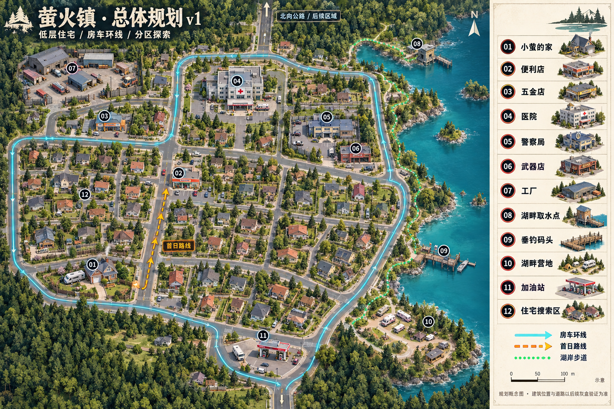

# 萤火镇：小镇总体规划 v1

日期：2026-10-17。用途：指导后续场景灰盒、道路验证、模型选择和资源点制作。本文为总体规划，不代表所有功能已经完成；道路和普通街区的第一批实现见 [实施记录](town_framework.md)。

概念图使用内置 imagegen 生成；完整提示词见 `town_map_image_prompt.txt`。图像约定地块关系与美术方向，本文约定功能与分批制作范围。展示图中的建筑造型不等同于项目已经拥有的模型。

## 城镇的样子

这是一座依湖而建的低层小镇。生活气息来自住宅、后院、车库、街角商店和湖岸，而不是高楼。灾变后的不安主要用弃车、封门、散落生活用品与局部损坏来表达，不把整座镇做成没有辨识度的废墟。

暂定全域约 500 × 600 米，包含东侧湖面、林带与道路；不是要求铺满建筑。镇区先预留约 50～70 栋住宅的位置，首版按资源和性能分批实现。住宅以 1～2 层为主，医院可达 3 层；工厂用单层大跨厂房、仓库和院落组成，不做高耸工业天际线。水塔等少量竖向地标可帮助辨向。

概念图优先表达相邻关系和探索结构，不能按插画像素测量施工。现有开篇家宅、后院房车、便利店作为第一条街的锚点保留；扩建围绕这条街推进。制作时保留现有 Godot 场景坐标，地图北向与游戏世界轴在灰盒阶段统一登记，不直接套用概念图尺寸搬移旧场景。

## 分区与道路

- 西南：开篇住宅区，小萤家、后院房车、邻居住宅。家宅前门朝启动街，后院有接入街道的侧车道。
- 中西部：生活商街，便利店为首个补给点；附近布置住宅搜索区和五金店。
- 西北：工厂、仓储、装卸院落。五金店作为生活区到工业区之间的过渡。
- 中北部：医院及停车场；东北侧为警察局与独立武器店。
- 东侧：湖泊、岸边取水设施、垂钓码头、湖畔营地和树林。
- 南入口：加油站及可回转的房车停车场；北侧公路预留后续区域出口。

房车道路采用外环加两条横向联络路，重要地点至少有一条车行到达路径。环线提供绕开障碍的余地；住宅小巷和湖岸步道允许步行捷径。首日路线由家后院接启动街，再到同一条街北侧的便利店；保持现有叙事顺序。

初始灰盒建议：主路净宽 8～10 米、支路 6～7 米、人行道 1.5～2 米；以实际房车包围盒测试交叉口，转弯处预留约 10～12 米外侧转弯半径并迭代。每个主要地点设置约 4 × 11 米房车车位与侧门外不小于 2 米的下车空间。所有尺寸为起步值，不代替碰撞和实际操控验证。

## 地点与物资循环

| 编号 | 地点 | 可获得物资 / 交互 | 空间与探索作用 |
| --- | --- | --- | --- |
| 01 | 小萤的家 | 序章、钥匙、后院房车；后续可找回个人物品 | 保留现有家宅和火灾开篇；初期只使用卧室与屋外，不承诺整栋可进入 |
| 02 | 便利店 | 食物、瓶装水、基础医疗品、零散维修材料、哥哥留言 | 保留已有可进入室内和四处搜刮；低门槛的首次探索 |
| 03 | 五金店 | 工具、紧固件、电线、胶带、管件；可扩展撬锁与维修能力 | 前店后仓，两条货架通道；为房车改装提供常用材料 |
| 04 | 医院 | 绷带、消毒剂、药品、医疗器材、电池；药房与病房柜搜索 | 地面层先做急诊与药房，楼层按进度分批开放；有较高搜索压力 |
| 05 | 警察局 | 通讯设备、防护用品、少量警用补给、道路与事件线索 | 接待区→办公室→上锁储物间；武器储藏不直接敞开 |
| 06 | 武器店 | 武器、有限弹药、清洁与维护组件 | 独立小店；可用钥匙、工具或任务解锁，避免开局轻易获得大量火力 |
| 07 | 工厂 | 金属件、机械部件、发动机维修组件、蓄电设备 | 厂房加装卸场，较大噪声和风险；承担较高阶改装资源 |
| 08 | 湖畔取水点 | 装取原水；泵房可作为维修目标 | 原水需要净化或煮沸才能作为游戏中的饮用水；净化耗材形成长期需求 |
| 09 | 垂钓码头 | 预留钓鱼、鱼类食材、饵料与渔具交互 | 初版先做码头和可交互钓点，垂钓玩法后续加入；不与取水点重复 |
| 10 | 湖畔营地 | 预留烹饪、休息、房车停靠与物资整理 | 林带中的阶段性喘息点；需玩家清理、修复后解锁，不设定为永久无敌区 |
| 11 | 加油站 | 有限燃料、油桶、车辆耗材 | 独立回转场与小卖部；油泵供电/取油可成为恢复任务 |
| 12 | 住宅搜索区 | 普通食物、布料、生活用品、小量随机材料、居民故事 | 住宅群中的 4～6 栋先设可进屋样板；其他住宅用门口/信箱/车库交互或外景表现 |

地图有很多房屋，不等于首版每栋都需要独立室内。核心功能建筑优先做可进入空间；住宅内装使用模块化房间模板和变化陈设，减少重复制作与加载成本。不可进入建筑也应有明确反馈，避免玩家逐门尝试却没有回应。

物资定位：便利店保生存、五金店做日常维修、医院补医疗、警局找通讯与防护、武器店补战斗装备、工厂供高级机械材料、加油站补燃料，湖岸提供需要加工的长期食物和水源。不会让一个商店解决全部需求。

## 探索顺序与叙事

1. 序章与首日：家中梦醒→绕后院→房车→便利店，拿到哥哥线索，保留现有首日改装流程。
2. 早期扩展：五金店、少量住宅与加油站；让“修理、补给、选择路线”成为第二个循环。
3. 需求驱动：受伤或医疗短缺推动医院；无线电/防护需求推动警局；武器店提供有门槛的额外选择，不强制固定顺序。
4. 中期目标：工厂支持更大规模的房车改装；湖畔取水、钓鱼、营地逐步提供稳定补给。
5. 区域出口：北向公路用于后续哥哥线索和离镇目标，当前仅预留位置。

插画的颜色用于区分功能，不把难度做成僵硬同心圈。实际风险依敌人、视线、噪声、入口和回撤路线设计；让玩家可以通过绕行与准备改变探索难度。

## 分批建模清单

**第一批：道路和比例灰盒。** 保留开篇与便利店，搭环路、侧车道、湖面及所有 POI 占地。用现有房车实测全环、路口、停车与右侧门上下车，用小萤实测人行通路。确认后再购买或替换大量建筑模型。

**第二批：生活街区。** 制作 6～8 种低层住宅外观模块（墙、屋顶、门窗、车库），组合院子、围栏、树木、颜色和朝向扩展住宅量；完成五金店和加油站。

**第三批：功能区。** 医院、警局、武器店、工厂优先使用单个主楼和明确入口，先做必要可玩区域。每栋增加一个街道识别物，如医院急诊雨棚、五金店室外货架、工厂装卸门。

**第四批：湖岸与细节。** 取水点、码头、营地、植被、弃车与叙事道具；再根据性能预算补足住宅数量和装饰。

室内沿用现有独立空间加载/切换方式；车辆、人物与前景建筑继续使用遮挡淡化。竖屏画面中入口前保留无遮挡空地，医院/厂房的高墙避开主要步行线。地面大轮廓先行，草木、垃圾、单件货架商品后加。

## 验收要点

- 所有关键建筑从房车道路可达，有停车、绕行和安全下车空间。
- 开篇家宅前门、后院路线、房车侧门方向与现有序章相容。
- 湖岸在陆地侧有连续步行路径；取水、垂钓和营地各有独立空间。
- 地标可辨认；前景遮挡不会让小萤消失；大多数建筑不超过两层。
- 原型阶段就用目标手机测试帧率、内存与加载，地图面积和房屋数可据此调整；不以电脑端表现代替移动端验收。
- 图上所有图标均为规划点，未实现功能标为预留，不对玩家宣称已经可玩。
